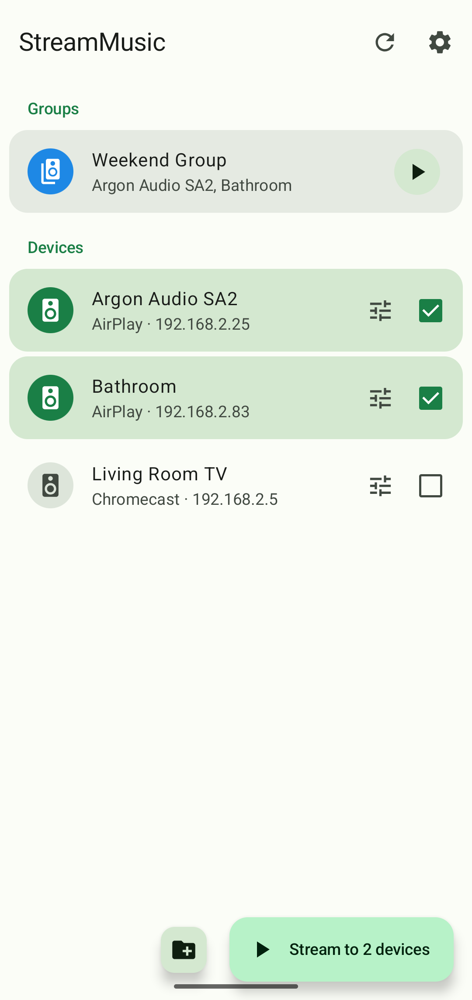
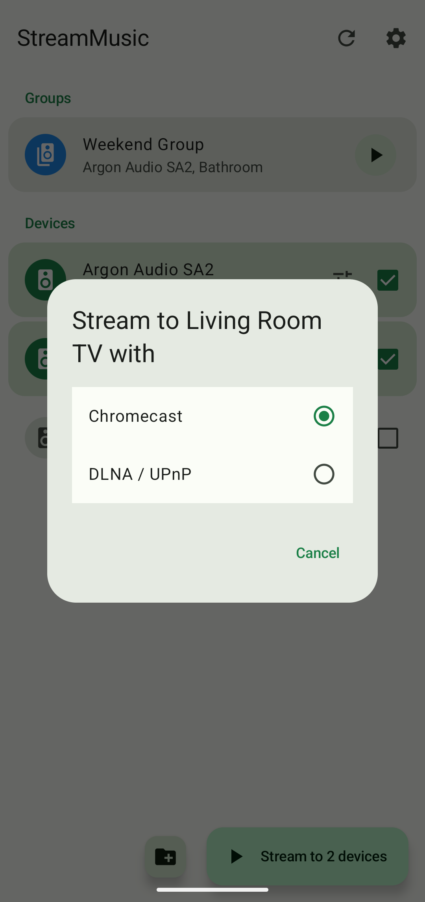
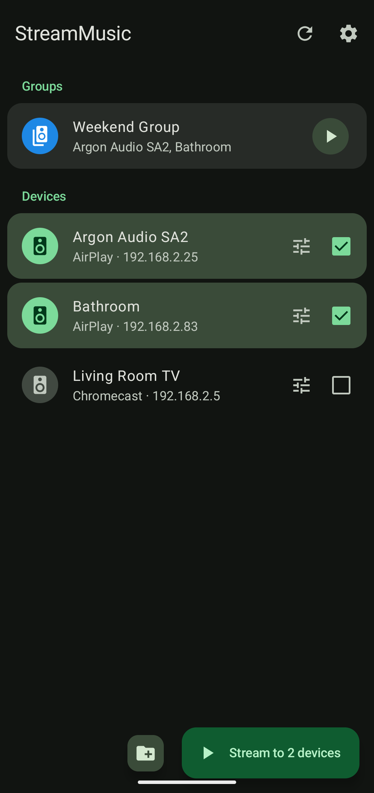
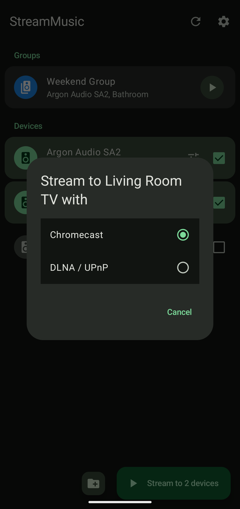

# StreamMusic

Stream your phone's audio to several speakers and TVs on your Wi-Fi at once. No Play Services, no account, no cloud.

<p>
  
  
  
</p>
<p>
  
  
  
</p>

## Why

I used AirMusic. It was removed from the Play Store, and my copy started saying "Trial mode" and beeping over the music. So I built this.

## Use

1. Open the app. It lists the devices it finds.
2. Tick one or more, tap **Stream to N devices**.
3. Allow the microphone and Android's screen-sharing dialog.

Tick or untick devices while streaming to add or remove them. Stop from the app or the notification.

## Supported

| Protocol | Devices |
|---|---|
| UPnP / DLNA | Sonos, HEOS, Samsung Multiroom, DLNA renderers |
| Chromecast | Cast speakers and TVs |
| AirPlay 1 and 2 | Receivers that pair without a code |
| AriaCast | AriaCast receivers |

Fire TV, Spotify Connect and Bose SoundTouch are listed but not supported.

## Limits

- Needs Android 14+, same network, IPv4 only.
- Captures all phone audio, no per-app filter.
- AirPlay is tested with unit tests and local fake receivers, not real speakers yet.
- More in [CLAUDE.md](CLAUDE.md#known-limits).

## Build

JDK 21 and the Android SDK.

```bash
./gradlew assembleDebug
./gradlew testDebugUnitTest
```

How the code is organised: [CLAUDE.md](CLAUDE.md).
